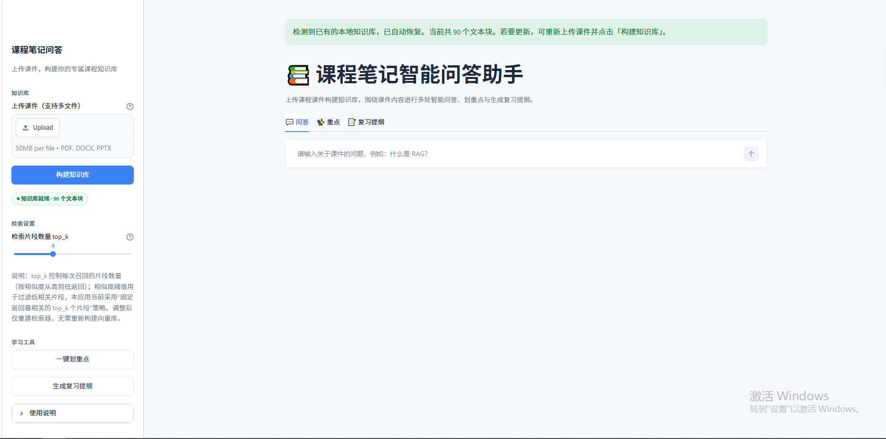
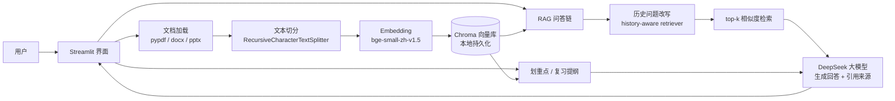

# 课程笔记智能问答助手（RAG）

> 上传课程 PPT / Word / PDF 课件，构建本地向量知识库，围绕课件内容进行多轮智能问答（带引用来源）、一键划重点、生成章节复习提纲。

**在线演示**：【Streamlit Cloud 部署后补充】

## 功能特性

- 📤 **多格式课件上传**：支持 `.pdf` / `.docx` / `.pptx` 多文件混合上传，自动去重同名文件
- 🗂️ **本地向量知识库**：中文递归切分（500 字/块、50 字重叠）+ 本地 bge Embedding + Chroma 持久化，重启应用自动恢复
- 💬 **多轮对话问答**：带历史问题改写，正确理解"它 / 这个"等指代追问；回答逐 token 流式输出
- 🛡️ **防幻觉约束**：只依据课件内容作答，资料中没有时明确回答"根据现有课件资料，未找到相关内容"，严禁编造
- 📚 **引用来源溯源**：每条回答展示来源标签（文件名 + 页码），并可展开查看检索到的原文片段
- ✨ **一键划重点**：基于整份课件输出 10~20 条核心知识点
- 📝 **复习提纲**：按"章节名 → 核心概念 → 要点"生成结构化 Markdown 提纲
- ⚙️ **检索参数可调**：侧边栏 top_k 滑块（2~8）实时调整召回数量，无需重建向量库




## 技术栈

| 环节 | 技术 | 说明 |
| --- | --- | --- |
| 语言 | Python 3.11 | |
| 大模型 | DeepSeek `deepseek-chat` | OpenAI 兼容接口 |
| Embedding | 本地 `BAAI/bge-small-zh-v1.5`（默认，离线免费）；可选通义 `text-embedding-v3` | 一键切换 |
| 编排框架 | LangChain 1.x（LCEL，langchain-classic 组合链） | |
| 向量库 | Chroma | 本地持久化 |
| 文档解析 | pypdf / python-docx / python-pptx | |
| 界面 | Streamlit | |
| 配置 | python-dotenv + .env | |

## 系统架构



## 目录结构

```
course-notes-qa/
├── app.py                     # Streamlit 入口（根目录，方便部署）
├── requirements.txt           # 主依赖
├── requirements-local-embed.txt  # 本地 Embedding 可选依赖（torch 等）
├── .env.example               # 环境变量模板
├── .gitignore
├── data/samples/              # 示例课件（PDF / DOCX / PPTX）
├── docs/                      # README 截图
├── vector_store/              # Chroma 持久化目录（已被 gitignore）
└── src/
    ├── config.py              # 环境变量与统一配置（密钥打码打印）
    ├── document_loader.py     # 三种格式文档加载 + 上传字节流兼容
    ├── splitter.py            # 中文递归字符切分
    ├── embeddings.py          # 本地 bge / 通义在线 Embedding 封装
    ├── vector_store.py        # Chroma 向量库构建 / 加载 / 检索器
    ├── rag_chain.py           # 带历史改写的 RAG 问答链（含流式输出）
    └── summary.py             # 划重点与复习提纲
```

## 本地运行

```powershell
# 1. 克隆并进入项目
git clone https://github.com/Sizeyu666/course-notes-qa.git
cd course-notes-qa

# 2. 创建虚拟环境（Python 3.11）
python -m venv .venv
.\.venv\Scripts\Activate.ps1

# 3. 安装依赖
pip install -r requirements.txt
# 本地 Embedding 方案还需安装（约 2GB，含 torch）：
pip install -r requirements-local-embed.txt

# 4. 配置密钥
copy .env.example .env
# 编辑 .env，填入 DEEPSEEK_API_KEY

# 5. 启动
streamlit run app.py
```

浏览器打开 `http://localhost:8501`，侧边栏上传课件 → 点击「构建知识库」→ 开始问答。

> Embedding 两种方案二选一：默认 `EMBEDDING_PROVIDER=local` 使用本地 bge 模型（首次自动下载约 100MB，已配置国内镜像）；也可改为 `dashscope` 使用通义在线接口（无需安装 torch，需配置 `DASHSCOPE_API_KEY`）。

## 部署 Streamlit Cloud

1. 把仓库推送到 GitHub（公开仓库）；
2. 打开 [share.streamlit.io](https://share.streamlit.io)，用 GitHub 登录 → **New app**；
3. 选择仓库 / 分支，Main file path 填 `app.py`；
4. 点开 **Advanced settings → Secrets**，把 `.streamlit/secrets.example.toml` 的内容粘贴进去并填入真实密钥；
5. 点击 **Deploy**，等待构建完成后获得 `https://xxx.streamlit.app` 链接。

部署前已做好的云端兼容处理：

- **Chroma / SQLite**：Linux 环境自动安装 `pysqlite3-binary`，`app.py` 顶部在任何第三方库导入前用它替换标准库 `sqlite3`，规避云端系统 SQLite 版本过旧导致的 Chroma 启动失败；
- **密钥读取**：`src/config.py` 按「系统环境变量 → .env → st.secrets」优先级读取，本地与云端同一套代码；
- **文件路径**：向量库使用相对路径 `./vector_store`（云端工作目录即仓库根目录），向量库不入库，云端为每用户会话临时构建；
- **Embedding 选型**：Streamlit Cloud 免费档内存约 1GB，**建议云端使用通义在线 Embedding**（secrets 中设 `EMBEDDING_PROVIDER="dashscope"`），避免安装约 2GB 的 torch；若坚持用本地 bge，需把 `requirements-local-embed.txt` 内容合并进 `requirements.txt`；
- **时区**：云端容器为 UTC，本应用不展示本地时间，不受影响。

部署后如报错，在 Streamlit Cloud 控制台右下角 **Manage app → Logs** 查看日志，常见问题（缺依赖、密钥未配、内存不足）日志中均有中文提示。

## 技术实现要点

### 多轮历史改写

使用 LangChain 1.x 的 `create_history_aware_retriever`：当用户提问包含"它 / 这个"等指代词时，先用一个独立的改写链（中文 prompt）结合聊天历史把问题改写成独立问题，再用改写后的问题做向量检索。这样"什么是 RAG" → "它有哪些优点"的多轮追问能正确命中课件内容。

### 防幻觉策略（三层）

1. **系统提示词强约束**：只能使用检索到的课件资料作答，资料中无依据时必须回答固定拒答语；
2. **代码侧归一化**：回答后由代码检测拒答语，命中时不附加任何来源标签，避免"拒答但还引用来源"的矛盾；
3. **引用来源确定性生成**：来源清单不依赖模型输出，而是由代码依据实际召回 chunk 的 metadata 生成并去重，杜绝模型乱标。

### 引用来源实现

召回的每个 chunk 在切分时写入 `chunk_index`（全局递增）、`source`（文件名）、`page`（页码/幻灯片序号）等 metadata。回答完成后，界面把召回文档渲染为来源标签胶囊，并提供可折叠面板查看每个片段的原文前 200 字，方便核对 RAG 检索质量。

### Chunk 切分参数

`chunk_size=500` / `chunk_overlap=50`：中文课件场景下，500 字能覆盖一个完整知识点的上下文（过小会切断语义，过大稀释检索精度）；50 字重叠保证跨块边界的句子不被截断。分隔符按 `\n\n → \n → 。！？； → 空格` 优先级递归切分，尽量在中文自然句读处断开。

### 向量库重建与持久化

重建时先删除同名旧 collection 再写入，避免新旧数据串库；Windows 上额外做了孤儿索引目录清扫与句柄释放。应用启动时检测磁盘上已有的 Chroma 库并自动恢复，无需重复上传构建。

## 常见问题 FAQ

**Q1：上传扫描版 PDF 后提示"未提取到任何文本"？**
扫描件没有文字层，pypdf 无法提取。请先用 OCR 工具（如 WPS / ABBYY）识别后再上传。

**Q2：首次使用本地 Embedding 很慢？**
首次运行需从 HuggingFace 国内镜像下载约 100MB 模型权重，之后全部走本地缓存。若网络受限，可改用 `EMBEDDING_PROVIDER=dashscope` 在线方案（需通义密钥）。

**Q3：回答提示"未配置 DEEPSEEK_API_KEY"？**
请在项目根目录的 `.env` 中填入 DeepSeek 密钥后重启应用。`.env` 已被 gitignore，不会被提交。

**Q4：想完全离线运行可以吗？**
Embedding 可以（本地 bge），但回答生成依赖 DeepSeek 在线接口，仍需联网调用。

## 免责声明

本项目仅用于个人学习与技术交流，不构成任何商业用途。上传的课件内容仅存储在本地向量库中，请确保你拥有课件的合法使用权。
